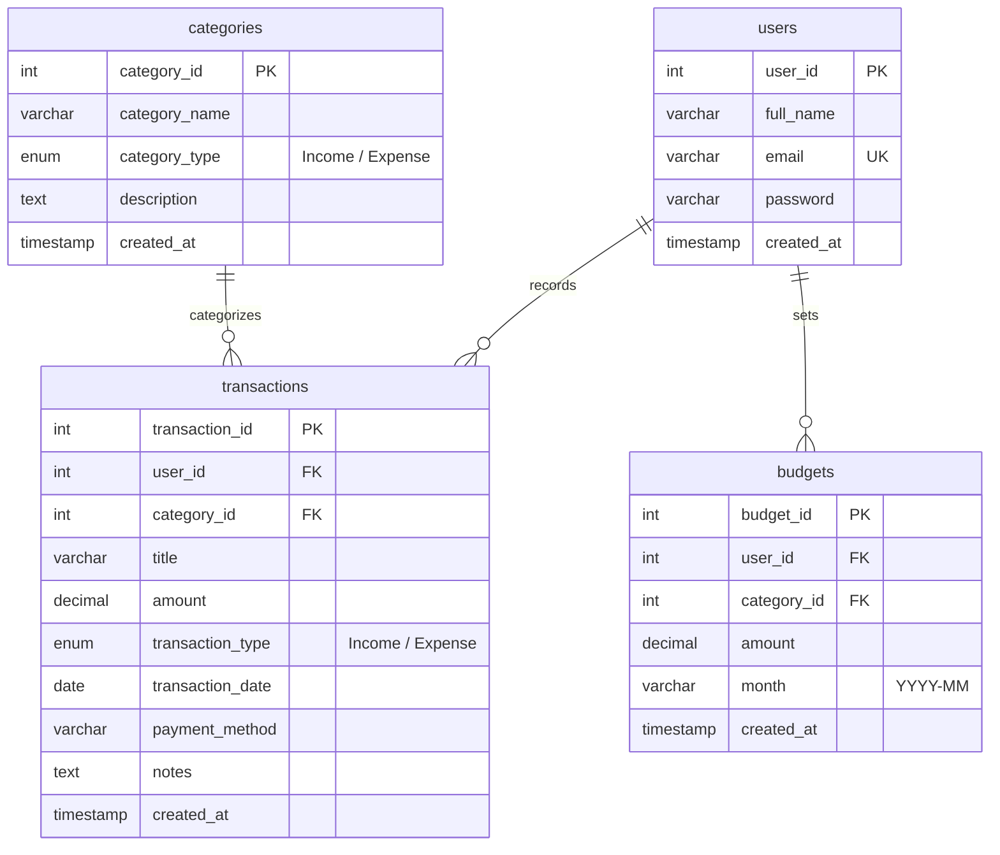

# Expense Tracker

A web-based personal expense and financial tracking system built with **PHP 8 (MVC Architecture)**, **MySQL/MariaDB (PDO)**, **HTML5**, **CSS3**, and **Bootstrap 5**.

The application allows users to securely register, log in, manage their personal income and expense records, categorize financial activities, set monthly spending budgets with automatic alert thresholds, and view visual analytics.

Final project for **Web Systems Technologies (PHP and MySQL Development)**.

**Live system:** [https://myexpensetracker.infinityfreeapp.com](https://myexpensetracker.infinityfreeapp.com)

---

## Features

- **Authentication & Security**:
  - Secure registration, login, and logout powered by PHP sessions.
  - Passwords hashed using PHP's native `password_hash()` (Bcrypt).
  - Session regeneration (`session_regenerate_id(true)`) upon authentication to prevent session fixation.
  - Protected routes: unauthorized guests are automatically redirected to the login page.
  - **Plain-text status notifications** positioned neatly above form fields (Green for success, Red for errors, Orange for missing required fields/warnings) without box containers.
- **Strict User Privacy (Multi-User Data Isolation)**:
  - Every user only accesses and modifies their own transactions, monthly budgets, and analytics (`WHERE user_id = ?`).
- **Dashboard Overview**:
  - Financial overview cards: **Total Income**, **Total Expenses**, **Current Net Balance**, and **Total Transactions**.
  - **Smart Budget Gauge**: Interactive progress bar tracking monthly spending against the set budget.
  - **Dynamic Budget Warnings**:
    - **Orange Warning:** Displayed when monthly spending reaches **80%** of the budget.
    - **Red Alert:** Displayed when monthly spending reaches or exceeds **100%** ("Over budget").
  - Table of the 5 most recent transactions with color-coded signed amounts (`+₱` in green for income, `−₱` in red for expense).
- **Transaction Management (CRUD)**:
  - Add, view, edit, and delete income and expense transactions.
  - Filter transactions by **Type** (`Income` vs `Expense`) and by **Month** (`YYYY-MM`).
  - Dynamic sum calculation of filtered income and expenses in the table footer.
- **Category Management (CRUD)**:
  - Add, view, edit, and delete financial categories.
  - Pre-seeded with Income categories (Salary, Business, Allowance, Savings) and Expense categories (Food, Transportation, Utilities, Education).
  - Relational integrity: categories currently linked to existing transactions cannot be deleted until those transactions are re-assigned or removed.
- **Monthly Budgeting**:
  - Set and modify monthly budget limits per user for any chosen month (`YYYY-MM`).
- **Reports & Financial Analytics**:
  - Monthly financial summary: Total Income, Total Expense, and Net Cash Flow.
  - Category breakdown table displaying total spending and percentage distribution.
  - 6-month historical trend table comparing income vs. expenses over time.
- **Responsive Minimalist UI**:
  - Custom design theme (Cream White `#FFF9F5`, Dark Slate `#344054`, Accent Teal `#237A70`) integrated with Bootstrap 5.3.

---

## Technologies Used

| Layer | Technology | Description |
|---|---|---|
| **Architecture** | **MVC (Model-View-Controller)** | Centralized front controller with object-oriented MVC structure |
| **Back-end** | **PHP 8.2** | OOP PHP, PDO database abstraction, Session handling |
| **Front-end** | **HTML5, CSS3, Bootstrap 5.3** | Responsive grid, cards, progress bars, custom minimalist styling |
| **Database** | **MySQL / MariaDB** | Relational database (InnoDB, UTF-8 mb4 encoding) |
| **Local Dev** | **XAMPP** | Apache web server, MariaDB on port 3307/3306, PHP 8.2 |
| **Hosting** | **InfinityFree** | Cloud production hosting & remote MySQL database |

---

## Project Structure (MVC Architecture)

Every web request is routed through the Front Controller at `public/index.php`. The router matches the `?route=...` query parameter against `config/routes.php` and executes the corresponding controller action.

```
expense_tracker/
├── app/
│   ├── Controllers/             # Controllers (handle user input & coordinate flow)
│   │   ├── AuthController.php        # Login, registration, and logout actions
│   │   ├── BudgetController.php      # Monthly budget allocation actions
│   │   ├── CategoryController.php    # Category management actions (CRUD)
│   │   ├── DashboardController.php   # Dashboard summary & recent transactions
│   │   ├── ReportController.php      # Monthly breakdown & historical analytics
│   │   └── TransactionController.php # Transaction management actions (CRUD)
│   ├── core/                    # Core framework classes
│   │   ├── Controller.php       # Base controller: render views, auth checks, redirects
│   │   ├── Database.php         # Singleton PDO database connector
│   │   ├── helpers.php          # Formatting helpers (peso(), h(), signedPeso(), url())
│   │   ├── Model.php            # Base model holding the shared PDO instance
│   │   └── Router.php           # Dispatches incoming route strings to controllers
│   ├── Models/                  # Data layer (SQL queries with prepared statements)
│   │   ├── Budget.php           # Queries for `budgets` table
│   │   ├── Category.php         # Queries for `categories` table
│   │   ├── Transaction.php      # Queries for `transactions` table & report aggregations
│   │   └── User.php             # Queries for `users` table (lookup, creation, email check)
│   ├── Views/                   # Presentation layer (HTML / PHP templates)
│   │   ├── header.php           # Shared navigation bar and layout header
│   │   ├── footer.php           # Shared layout footer
│   │   ├── login.php            # User login view with plain-text status feedback
│   │   ├── register.php         # User registration view
│   │   ├── dashboard.php        # Primary overview dashboard
│   │   ├── transactions.php     # Transactions table with filters and totals
│   │   ├── transaction_form.php # Shared Add/Edit transaction form
│   │   ├── categories.php       # Category list with transaction counts
│   │   ├── category_form.php    # Shared Add/Edit category form
│   │   ├── budget.php           # Monthly budget allocation view
│   │   ├── reports.php          # Financial reports and category expense distribution
│   │   └── 404.php              # Custom 404 not-found page
│   └── .htaccess                # Blocks direct HTTP access to the app/ directory
├── config/
│   ├── database.php             # Database credentials configuration array
│   ├── routes.php               # Route mapping table (URL route => [Controller, Method])
│   └── .htaccess                # Blocks direct HTTP access to credentials
├── public/                      # Web-accessible public root
│   ├── index.php                # Front controller (bootstraps session, autoloader, router)
│   ├── logo.png                 # Application brand logo
│   └── style.css                # Custom minimalist styling and notification classes
├── index.php                    # Root entry point that forwards visitors to public/
├── database.sql                 # Complete database schema and initial seed data export
└── README.md                    # Project documentation
```

### Application Routes

| Route (`index.php?route=`) | Controller Action | Description |
|---|---|---|
| `login` | `AuthController->login()` | User authentication / login form |
| `register` | `AuthController->register()` | New user registration form |
| `logout` | `AuthController->logout()` | Clears session and logs out user |
| `dashboard` *(or blank)* | `DashboardController->index()` | Primary financial dashboard |
| `transactions` | `TransactionController->index()` | View, filter, and review transactions |
| `transactions/add` | `TransactionController->create()` | Form to record new income or expense |
| `transactions/edit&id=X` | `TransactionController->edit()` | Form to modify an existing transaction |
| `transactions/delete` | `TransactionController->delete()` | Deletes a transaction |
| `categories` | `CategoryController->index()` | View all categories |
| `categories/add` | `CategoryController->create()` | Form to add a new category |
| `categories/edit&id=X` | `CategoryController->edit()` | Form to update category name |
| `categories/delete` | `CategoryController->delete()` | Deletes an unused category |
| `budget` | `BudgetController->index()` | Set or update monthly budget |
| `reports` | `ReportController->index()` | View monthly report and expense breakdown |

---

## Database Design & Schema

- **Database Name (Local):** `expense_tracker_db`
- **Engine:** InnoDB | **Collation:** `utf8mb4_general_ci`
- **Export File:** `database.sql`



### Table Definitions

#### 1. `users` (Account Credentials)
| Field | Type | Constraints / Notes |
|---|---|---|
| `user_id` | `INT(11)` | `PRIMARY KEY`, `AUTO_INCREMENT` |
| `full_name` | `VARCHAR(100)` | `NOT NULL` |
| `email` | `VARCHAR(100)` | `NOT NULL`, `UNIQUE` |
| `password` | `VARCHAR(255)` | `NOT NULL` (Bcrypt hashed) |
| `created_at` | `TIMESTAMP` | `DEFAULT current_timestamp()` |

#### 2. `categories` (Income and Expense Categories)
| Field | Type | Constraints / Notes |
|---|---|---|
| `category_id` | `INT(11)` | `PRIMARY KEY`, `AUTO_INCREMENT` |
| `category_name` | `VARCHAR(100)` | `NOT NULL` |
| `category_type` | `ENUM('Income','Expense')` | `NOT NULL` |
| `description` | `TEXT` | `NULL` |
| `created_at` | `TIMESTAMP` | `DEFAULT current_timestamp()` |

#### 3. `transactions` (Primary Financial Ledger)
| Field | Type | Constraints / Notes |
|---|---|---|
| `transaction_id` | `INT(11)` | `PRIMARY KEY`, `AUTO_INCREMENT` |
| `user_id` | `INT(11)` | `NOT NULL`, `FOREIGN KEY` references `users(user_id)` |
| `category_id` | `INT(11)` | `NOT NULL`, `FOREIGN KEY` references `categories(category_id)` |
| `title` | `VARCHAR(150)` | `NOT NULL` |
| `amount` | `DECIMAL(10,2)` | `NOT NULL` |
| `transaction_type` | `ENUM('Income','Expense')` | `NOT NULL` |
| `transaction_date` | `DATE` | `NOT NULL` |
| `payment_method` | `VARCHAR(50)` | `NULL` |
| `notes` | `TEXT` | `NULL` |
| `created_at` | `TIMESTAMP` | `DEFAULT current_timestamp()` |

#### 4. `budgets` (Monthly Budgets)
| Field | Type | Constraints / Notes |
|---|---|---|
| `budget_id` | `INT(11)` | `PRIMARY KEY`, `AUTO_INCREMENT` |
| `user_id` | `INT(11)` | `NOT NULL`, `FOREIGN KEY` references `users(user_id)` |
| `category_id` | `INT(11)` | `NULL` (NULL indicates an overall monthly budget) |
| `amount` | `DECIMAL(10,2)` | `NOT NULL` |
| `month` | `VARCHAR(7)` | `YYYY-MM` format (e.g. `2026-11`) |
| `created_at` | `TIMESTAMP` | `DEFAULT current_timestamp()` |

---

## Setup Instructions (Local Development with XAMPP)

1. **Start XAMPP**:
   - Open the **XAMPP Control Panel** and start **Apache** and **MySQL**.
2. **Clone / Place the Project**:
   - Ensure the project directory is located inside your XAMPP web root:
     ```
     C:\xampp\htdocs\expense_tracker\
     ```
3. **Import Database**:
   - Open phpMyAdmin in your browser: `http://localhost/phpmyadmin/`.
   - Create a new database named `expense_tracker_db` with `utf8mb4_general_ci` collation.
   - Click the **Import** tab, select `database.schema.sql` from the root of this project, and click **Import** (Go). This file contains table definitions only; it does not include account or transaction records.
4. **Verify Database Configuration**:
   - Copy `config/database.example.php` to `config/database.php` and set your local connection parameters. The local `database.php` file is ignored by Git:
     ```php
     return [
         'host'    => '127.0.0.1',
         'port'    => 3306, // Use the MySQL port configured in XAMPP.
         'name'    => 'expense_tracker_db',
         'user'    => 'root',
         'pass'    => '',
         'charset' => 'utf8mb4',
     ];
     ```
5. **Run the Application**:
   - Navigate to:
     ```
     http://localhost/expense_tracker/
     ```
   - You will automatically be forwarded to `public/index.php?route=login`. Click **Register** to create your account and start using the system.

---

## Online Deployment

1. Create a database with your hosting provider and open its phpMyAdmin.
2. Import `database.schema.sql` to create the tables. It contains no account or transaction records.
3. Upload the project files to your host's web root.
4. Copy `config/database.example.php` to `config/database.php` on the server and set the connection values supplied by your host:
   ```php
   return [
       'host'    => 'YOUR_DATABASE_HOST',
       'port'    => 3306,
       'name'    => 'YOUR_DATABASE_NAME',
       'user'    => 'YOUR_DATABASE_USER',
       'pass'    => 'YOUR_DATABASE_PASSWORD',
       'charset' => 'utf8mb4',
   ];
   ```
5. Open your site's URL and register an account to begin using the application.

---

## Security Practices Implemented

- **Prepared Statements (PDO)**: All dynamic SQL queries bind parameters using PDO placeholders (`?`), completely preventing SQL injection vulnerabilities.
- **Cross-Site Scripting (XSS) Prevention**: User-supplied data rendered in HTML is sanitized through the `h()` helper function using `htmlspecialchars($val, ENT_QUOTES, 'UTF-8')`.
- **Session Protection**: `session_regenerate_id(true)` is executed upon login to prevent session hijacking and fixation attacks.
- **Server-Side Authorization**: Every controller action verifies authentication via `$this->requireLogin()`, and every data query enforces user boundaries (`WHERE user_id = ?`).
- **File Protection**: `.htaccess` files protect `app/` and `config/` from direct browser access.

---

## Author

**Juliana Bayson**  
Web Systems Technologies (PHP and MySQL Development)
